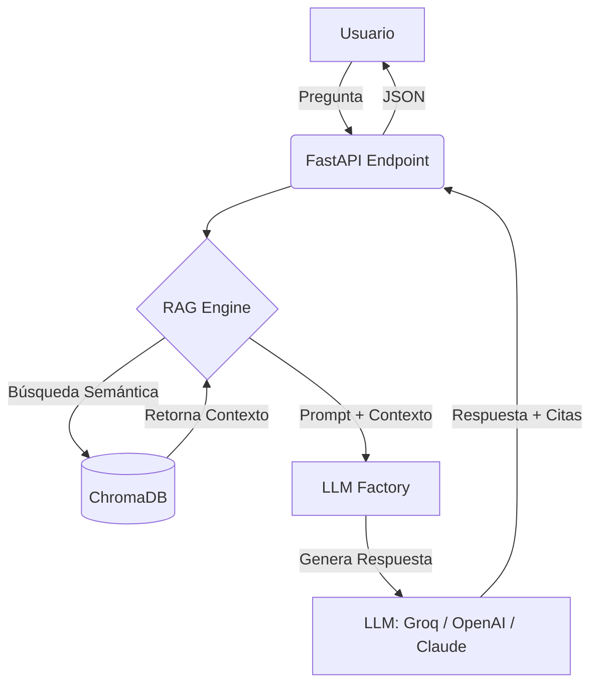
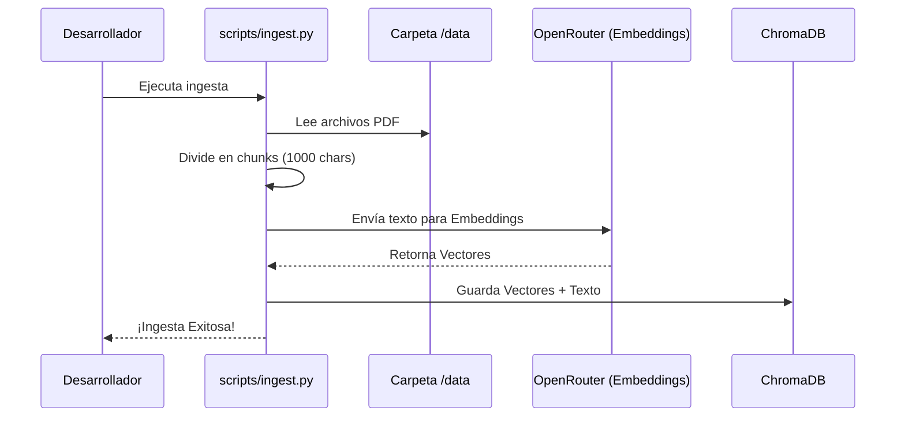

# Architecture Design

## 1. Diagrama de Flujo (Data Pipeline)

## 2. Flujo de Ingesta (Offline)

## 3. Componentes de Software
- **API Layer:** FastAPI (endpoints asíncronos y documentados con Swagger).
- **Ingestion Layer:** Script de Python que extrae texto de PDFs (`PyPDFLoader`) y los divide (`RecursiveCharacterTextSplitter`).
- **Vector Store:** ChromaDB (base de datos local persistente).
- **Embeddings:** Generados vía OpenRouter (`openai/text-embedding-3-small`).
- **LLM Provider:** Groq (`llama-3.3-70b-versatile`) configurado para respuestas ultrarrápidas.

## 4. Patrones de Diseño Aplicados
- **Registry Pattern (Factory Mejorado):** Utilizado en `llm_factory.py` y `embeddings_factory.py`. En lugar de una cadena de `if/elif` (que viola el principio Open/Closed de SOLID), usamos un diccionario (`_PROVIDER_REGISTRY`) que mapea el nombre del proveedor a su función constructora. Agregar un nuevo proveedor solo requiere crear una función y añadir una línea al diccionario, sin modificar la lógica central.
- **LCEL (LangChain Expression Language):** Uso de tuberías (`|`) para construir la cadena de ejecución de forma declarativa.