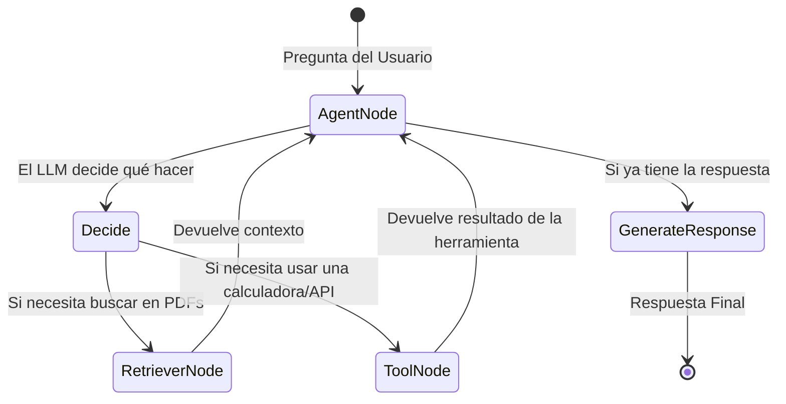

# Ingeniería de Software: Principios, Patrones y Flujos

Este documento detalla las decisiones arquitectónicas y de diseño de software tomadas durante el desarrollo del **Advanced RAG Evaluator**. El objetivo es demostrar cómo el código no solo funciona, sino que está diseñado para ser escalable, mantenible y testeable.

## 1. Principios SOLID Aplicados

Aunque Python es un lenguaje dinámico, aplicamos principios de diseño orientado a objetos para mantener la calidad del código.

### S - Single Responsibility Principle (Responsabilidad Única)
Cada clase y módulo tiene una única razón para cambiar.
*   `RAGEngine`: Solo se encarga de orquestar la búsqueda y la generación.
*   `llm_factory.py`: Solo se encarga de instanciar modelos de lenguaje.
*   `embeddings_factory.py`: Solo se encarga de instanciar modelos de embeddings.
*   `config.py`: Solo se encarga de cargar y validar variables de entorno.

### O - Open/Closed Principle (Abierto/Cerrado)
El código está abierto a extensión, pero cerrado a modificación.
*   **Implementación:** Usamos el **Registry Pattern** en `llm_factory.py`. Si mañana queremos agregar soporte para Mistral o Cohere, no tocamos la lógica central de `get_llm()`. Simplemente creamos una nueva función `_build_mistral()` y la agregamos al diccionario `_PROVIDER_REGISTRY`. La función principal queda intacta.

### L - Liskov Substitution Principle (Sustitución de Liskov)
Los objetos de una clase derivada deben poder sustituir a los objetos de la clase base sin alterar el correcto funcionamiento del programa.
*   **Implementación:** Al usar las abstracciones de LangChain (`BaseChatModel` y `Embeddings`), todos los proveedores (OpenAI, Groq, Claude, etc.) devuelven objetos que heredan de estas interfaces. El `RAGEngine` no sabe ni le importa qué proveedor está usando; simplemente llama a `.ainvoke()` y funciona.

### I - Interface Segregation Principle (Segregación de Interfaces)
Los clientes no deben verse obligados a depender de interfaces que no utilizan.
*   **Implementación:** No usamos una interfaz gigante para todo. LangChain separa `ChatModels` de `Embeddings`. Nuestro código respeta esa segregación: la ingesta usa Embeddings, la generación usa ChatModels.

### D - Dependency Inversion Principle (Inversión de Dependencias)
Depende de abstracciones, no de concreciones.
*   **Implementación:** El `RAGEngine` no importa directamente `ChatGroq` o `ChatOpenAI`. En su lugar, importa la abstracción `get_llm()`, que decide internamente qué concreto usar. Esto permite cambiar el proveedor sin tocar el motor RAG.

---

## 2. Patrones de Diseño Utilizados

### Registry Pattern (Fábrica Mejorada)
*   **Dónde:** `app/core/llm_factory.py` y `app/core/embeddings_factory.py`.
*   **Qué es:** En lugar de una cadena de `if/elif`, usamos un diccionario (`_PROVIDER_REGISTRY`) que asocia una llave (ej. `"GROQ"`) con una función constructora.
*   **Beneficio:** Elimina la complejidad cognitiva, cumple con el principio Open/Closed y facilita los tests unitarios (podemos mockear el diccionario directamente).

### Strategy Pattern (Implícito)
*   **Dónde:** En la elección del LLM.
*   **Qué es:** Permite cambiar el algoritmo (en este caso, el modelo de lenguaje) en tiempo de ejecución sin cambiar el código del cliente. El `.env` define la "estrategia" a usar.

### Singleton Pattern (Configuración)
*   **Dónde:** `app/core/config.py`.
*   **Qué es:** La clase `Settings` de Pydantic se instancia una sola vez y se exporta como `settings`. Todos los módulos importan la misma instancia, evitando recargar las variables de entorno en cada llamada.

### Factory Pattern (Para Embeddings)
*   **Dónde:** `app/core/embeddings_factory.py`.
*   **Qué es:** Al igual que el LLM, los embeddings necesitan cambiar según el entorno (OpenRouter vs HuggingFace). La fábrica encapsula la creación de la instancia correcta.

---

## 3. Grafos de Estados (LangGraph vs LCEL)

Actualmente, el proyecto utiliza **LCEL (LangChain Expression Language)** para construir la cadena de ejecución del RAG. Sin embargo, hemos evaluado la implementación de **Grafos de Estado** para futuras iteraciones.

### Lo que tenemos hoy: LCEL (Pipeline Lineal)
```python
chain = (
    {"context": self.retriever | self._format_docs, "input": RunnablePassthrough()}
    | self.prompt
    | self.llm
    | StrOutputParser()
)
```

- **Ventaja**: Es extremadamente rápido, declarativo y fácil de testear.
- **Desventaja**: Es un flujo lineal. El LLM no puede "decidir" volver atrás o buscar más información.

**Lo que se viene: LangGraph (Grafos de Estado)**
LangGraph es ideal para agentes autónomos. Su flujo se ve así:



- **¿Para qué serviría?**

1. **Agentes Autónomos**: Si el usuario pregunta algo que no está en los PDFs, el agente podría decidir buscar en internet (Tool Calling).
2. **Ciclos de Corrección**: Si el LLM genera una respuesta y un nodo de "Evaluación" detecta que es una alucinación, el grafo podría volver atrás y pedirle al LLM que lo intente de nuevo.
3. **Multi-Agente**: Un agente "Investigador" que busca en PDFs, y un agente "Escritor" que redacta la respuesta final.

**¿Por qué no se implementó LangGraph aún?**
Para un sistema RAG simple (Consulta -> Búsqueda -> Respuesta), LCEL es más que suficiente y más eficiente. LangGraph añade una sobrecarga de configuración que no se justifica hasta que el flujo deja de ser lineal (por ejemplo, cuando se necesita memoria conversacional compleja o herramientas externas).

## 4. Estructura de los Tests (Mocking Strategy)
Para alcanzar el 100% de cobertura sin depender de APIs externas, implementamos una estrategia de **Mocking**:

1. **Mock de LLM**: En lugar de llamar a Groq/OpenRouter, inyectamos un `AIMessage` simulado con metadatos de tokens.
2. **Mock de ChromaDB:** Simulamos los documentos recuperados para probar la lógica de extracción de fuentes y formateo de contexto.
3. **Mock de Configuración**: Usamos `monkeypatch` en `conftest.py` para inyectar variables de entorno falsas y evitar que los tests lean el `.env` real.

Esta separación asegura que los tests sean rápidos (milisegundos) y gratuitos (no consumen tokens).

